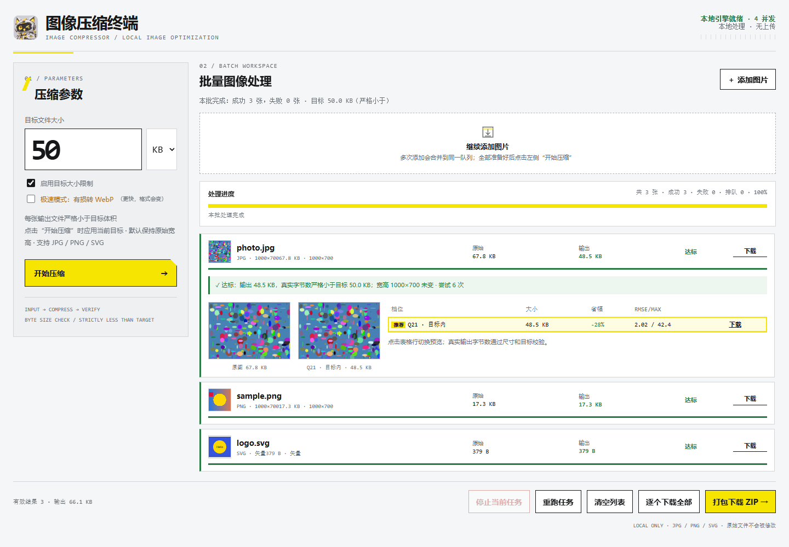

# 图像压缩终端 / Image Compressor Terminal

一个完全离线运行的单文件图片压缩工具，采用白/黄工业科技风界面。所有压缩均在本机浏览器内通过 WebAssembly 与 Web Worker 完成，图片不会上传到任何服务器。

A completely offline, single-file batch image compressor with a white/yellow industrial UI. All compression runs locally in your browser via WebAssembly and Web Workers—no images are ever uploaded to any server.



---

## 核心功能 / Features

- **严格目标文件大小 / Strict Target File Size**：默认启用（预填 `500 KB`，支持自定义 KB/MB），输出文件真实字节数严格小于目标值。
- **保持原始分辨率 / Original Dimensions Preserved**：JPG/PNG 不缩放尺寸；SVG 保留原始宽高属性与 `viewBox`。
- **批量队列与并发 / Batch Queue & Web Worker Pool**：多次导入自动合并至同一队列；根据 CPU 核心数自动开启 1～4 个 Worker 并行压缩。
- **会话级缓存 / Session Cache**：同一次页面会话内，相同文件与相同目标参数直接复用成功结果。
- **可选 WebP 极速模式 / Optional Fast WebP Mode**：默认关闭；开启后允许有损转为 WebP，速度更快（格式会变为 `.webp`）。
- **停止与重跑 / Stop & Rerun**：支持随时中止队列，并按新目标重跑全部已有任务。
- **多种导出方式 / Flexible Export**：支持单张下载、逐个下载全部、以及将成功结果打包为 ZIP 下载。
- **纯前端零请求 / Zero Network Requests**：无后端、无外部字体或图片请求，构建产物为自包含单文件 HTML。

---

## 直接使用 / Quick Start

直接用浏览器打开仓库中已构建好的单文件版本即可使用，无需安装或启动服务器：

Open the pre-built standalone HTML file directly in any modern browser—no installation or server required:

```text
dist/图片压缩器.html
```

完整便携启动包位于 `dist/` 目录，内含 Windows 图标、启动脚本及桌面快捷方式安装脚本。

---

## 本地开发与构建 / Local Development

需要 **Node.js 22+**（已在 Node 24 上验证通过）：

Requires **Node.js 22+** (verified on Node 24):

```bash
npm install
npm run build
```

构建脚本 `build.mjs` 会完成以下流程 / What `npm run build` does:

1. 使用 `esbuild` 打包主界面逻辑与 Worker；
2. 读取 `@jsquash/jpeg`、`@jsquash/png`、`@jsquash/oxipng` 的 WASM 模块；
3. 将 WASM 与 Worker 源码内联为单个自包含文件；
4. 输出 `dist/图片压缩器.html`，并同步更新 `docs/index.html`。

### 目录结构 / Project Structure

```text
index.html                 页面结构、白黄工业风 CSS 与入场动画
src/app.js                 页面控制、事件驱动队列、停止/重跑与 ZIP 导出
src/card.js                任务卡片渲染、对比预览与档位同步切换
src/cache.js               会话级 LRU 缓存（兼容 file:// 离线哈希）
src/pipeline.js            目标大小二分搜索、真实字节/尺寸校验、WebP 路径
src/worker.js              Web Worker 入口
src/worker-pool.js         Worker 池、预编译 WASM 共享与任务分发
src/codecs.js              MozJPEG / OxiPNG / SVGO 编解码封装
src/metrics.js             RMSE / MAX 误差评估与调色板量化
src/format.js              文件大小格式化
assets/                    应用图标与设计素材
docs/                      设计规范、参考图、截图与 GitHub Pages 入口
test/                      Playwright 自动化回归测试
build.mjs                  单文件构建脚本
```

---

## 目标大小实现原理 / How Target Size Works

- **JPG**：在 `1–95` 质量区间内二分搜索，并以真实编码字节数及解码后的像素尺寸做最终校验。
- **PNG**：优先尝试无损压缩；若当前颜色档位超标，先提高压缩级别，再逐步尝试降色量化并重新解码校验。
- **WebP 极速模式（可选）**：调用浏览器原生 `OffscreenCanvas` 进行二分质量编码；若环境不支持则自动回退到原格式路径。
- **严格兜底**：若无法在保持格式与尺寸的前提下压到目标体积以下，任务会进入未达标区域，绝不将超标文件伪装为成功。

---

## 自动化测试 / Testing

测试基于 Python + Playwright + Pillow：

```bash
pip install -r test/requirements.txt
python -m playwright install chromium
python test/spec_check.py
```

其他专项回归脚本 / Additional regression scripts:

```bash
python test/target_check.py
python test/target_timing.py
python test/queue_zip_check.py
python test/stop_rerun_check.py
python test/fast_webp_check.py
python test/offline.py
```

---

## GitHub Pages 在线部署 / GitHub Pages

仓库已包含同步生成的 `docs/index.html`（详见 [GITHUB_UPLOAD.md](GITHUB_UPLOAD.md)）：

1. 进入仓库 **Settings → Pages**；
2. **Source** 选择 `Deploy from a branch`；
3. **Branch** 选择 `main`，目录选择 `/docs` 并保存，即可在线访问。

---

## 隐私说明 / Privacy

- 所有图片、压缩结果与缓存仅保存在浏览器内存中。
- 页面不发起任何外部网络请求；图标、背景、WASM 与 Worker 均已本地内联。
- 关闭页面后，缓存与任务列表自动清空，原始文件不会被修改。

---

## 设计资料 / Design References

- [设计规范 / UI Spec](docs/compressor-ui-spec.md)
- [02 号视觉参考图 / Reference 02](docs/reference-02.png)
- [白黄工业风界面截图 / Main UI Screenshot](docs/screenshots/界面-白黄工业风.png)
- [400 KB 目标验证截图 / 400 KB Target Verification](docs/screenshots/界面-目标400KB验证.png)

---

## 许可证与第三方声明 / License & Notices

本仓库目前**尚未为整体项目指定开源许可证**。如需公开发布，请根据实际需求补充 `LICENSE` 文件（如 MIT / Apache-2.0），并确认代码与设计素材的授权范围。

- 应用图标、设计参考图和界面设计由项目所有者提供，未附加再分发许可。
- 第三方开源依赖许可详见 [THIRD_PARTY_NOTICES.md](THIRD_PARTY_NOTICES.md)。
